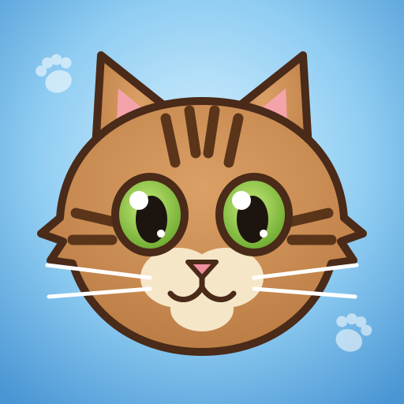
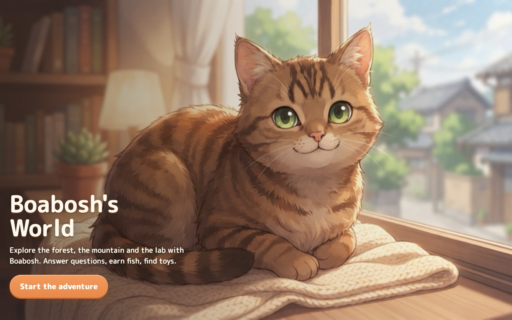
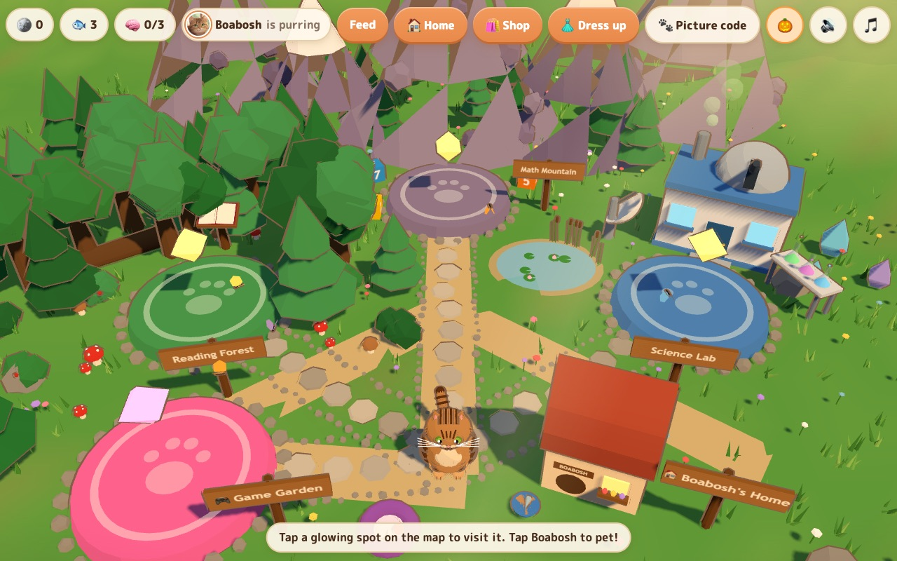
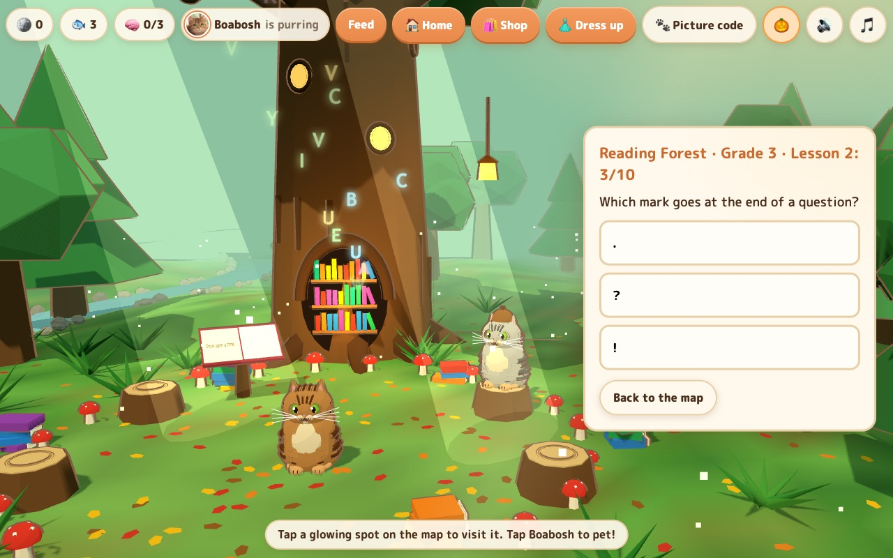
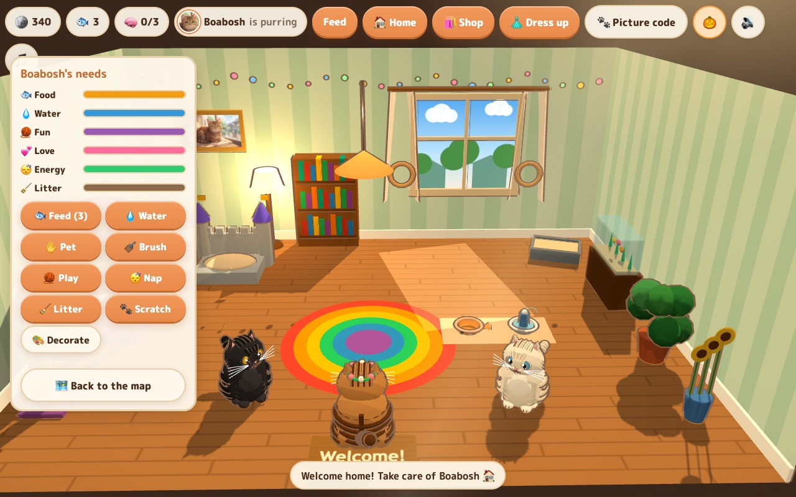
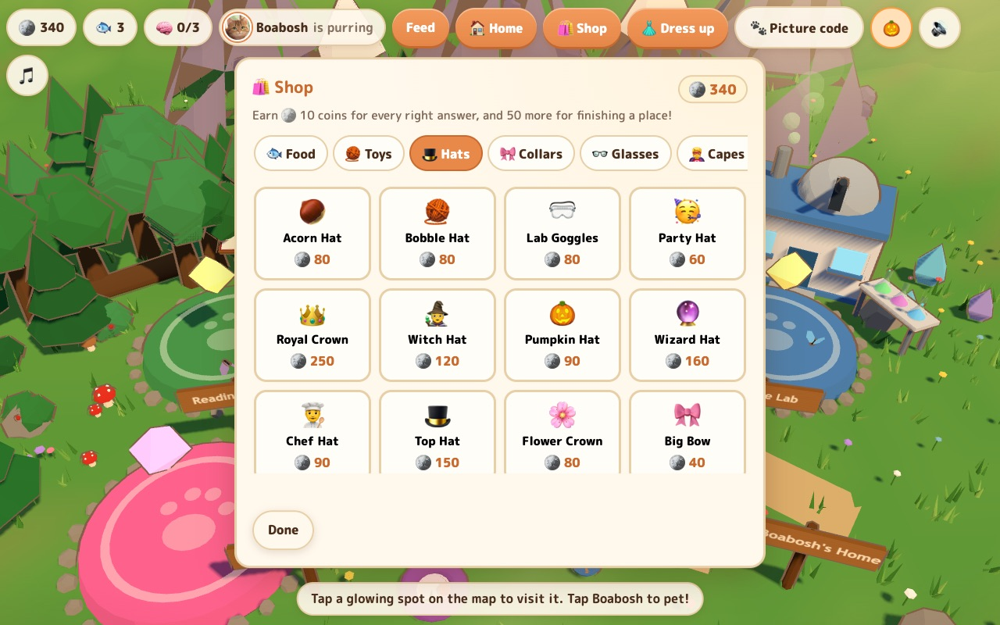
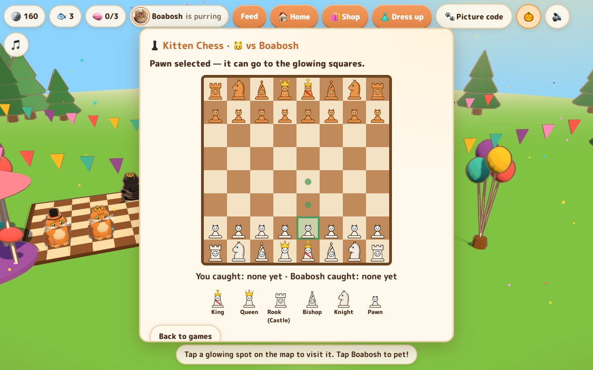
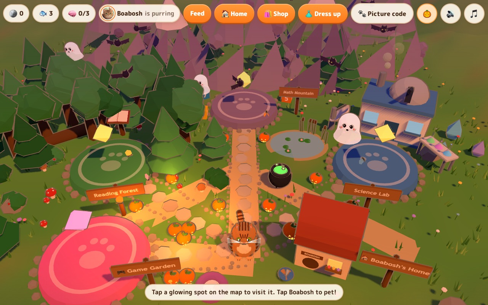

<p align="center"></p>

<h1 align="center">Boabosh's World</h1>

<p align="center">A cozy 3D learning game for kids in grades 2–4.<br />Learn with Boabosh the tabby cat, earn coins, and take care of your cats.</p>



## Learn

Walk Boabosh to the **Reading Forest**, **Math Mountain** and **Science Lab**. Questions
get harder as you improve (grades 2 to 4), rarely repeat, and every 10 right answers
finishes a lesson with confetti. Boabosh cheers for right answers and gently
encourages after wrong ones.




## Care and decorate

Right answers earn 🪙 coins. Spend them in the **Shop** on clothes, toys, food, furniture
and new cats. At **home**, feed, water, pet, brush and play with your cats, scoop the
litter, and decorate the room your way.




## Play

The **Game Garden** has Kitten Chess, Kitten Tic-Tac-Toe and Paw Rock-Paper-Scissors.
Play against Boabosh or a friend on the same device. Games cost coins **and** need a full
🧠 brain meter (3 right answers since the last game), so it's always learn a bit, play a bit.



## Seasonal

In October the world turns into a friendly Halloween sunset, with pumpkins, giggling
ghosts and bats. The 🎃 button turns it off.



## Run it

```bash
npm install
npm run dev
```

Saves stay on the device. To move cats between devices with a 🐾 **picture code**,
connect Supabase. See [docs/DEVELOPING.md](docs/DEVELOPING.md) for that, plus tests
and how the code is laid out.
