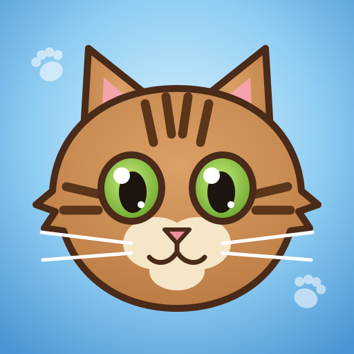
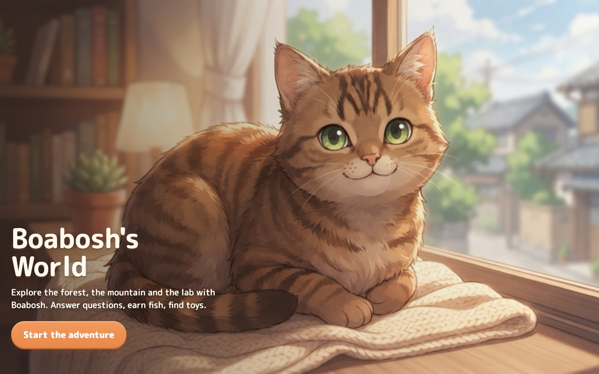
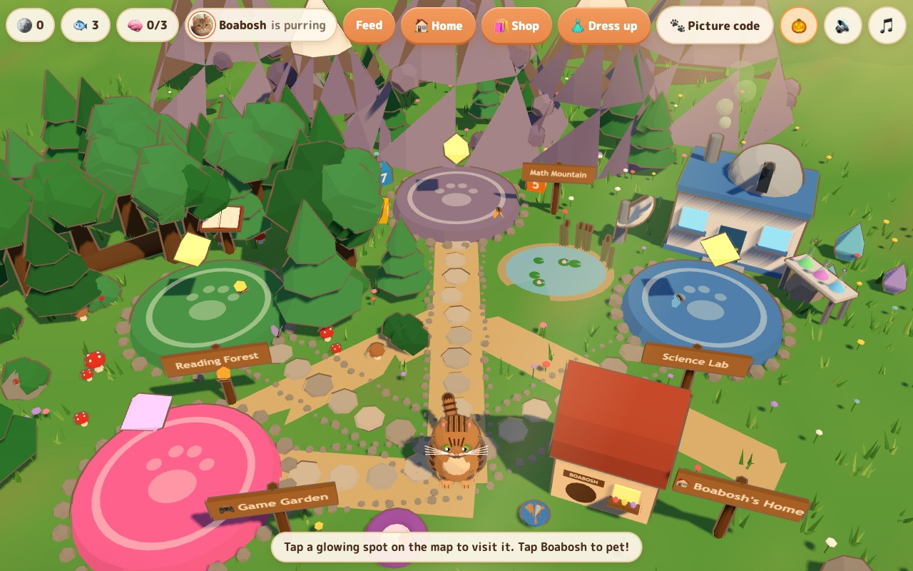
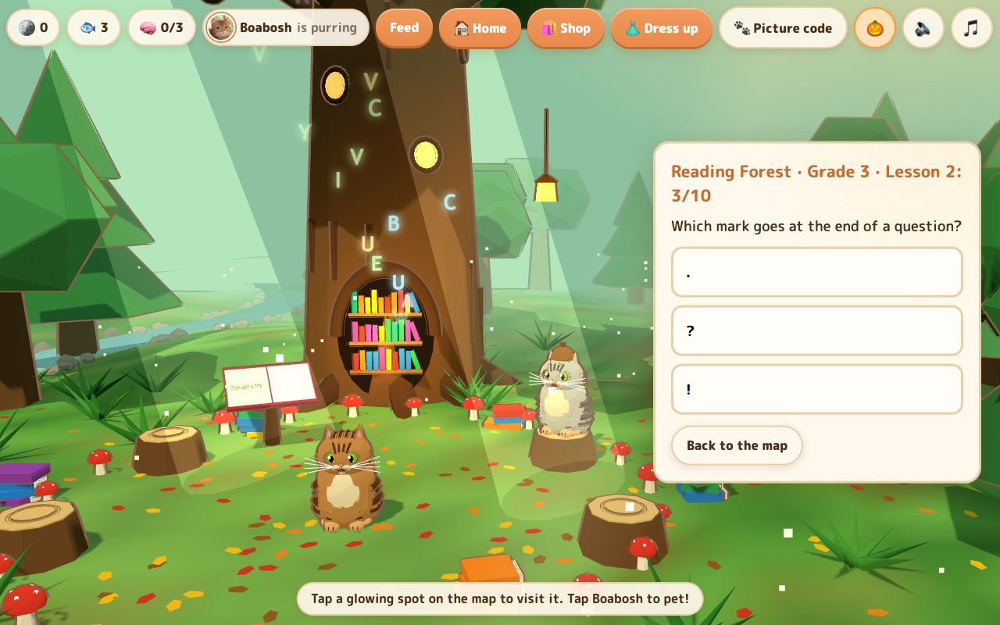
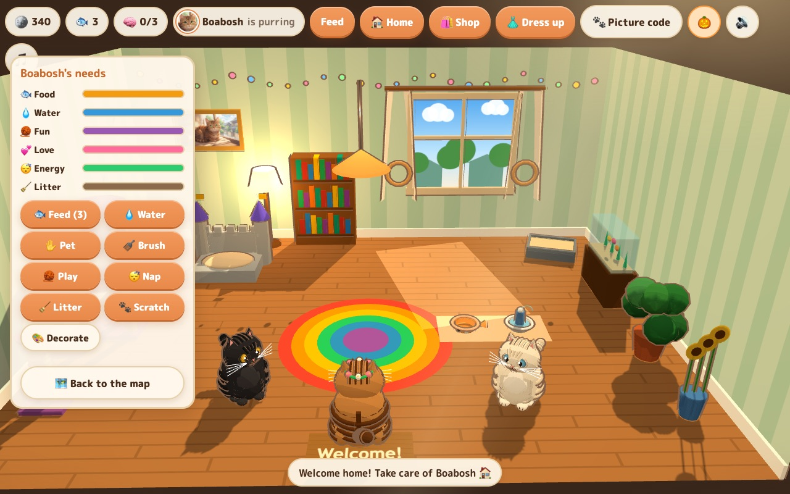
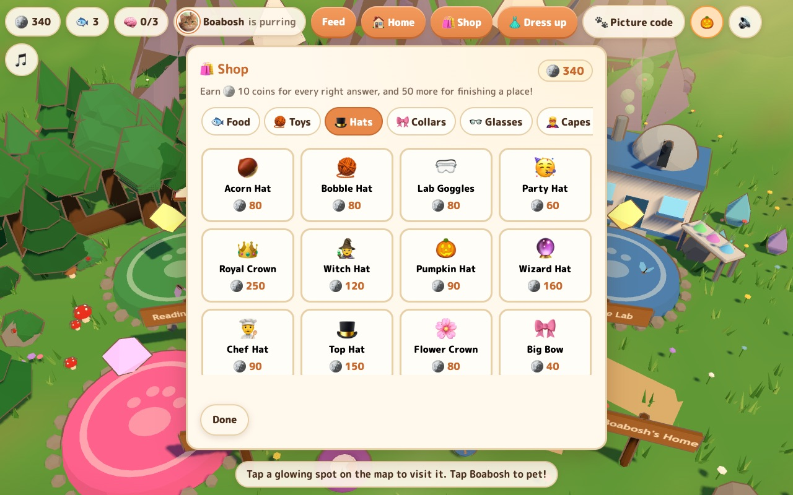
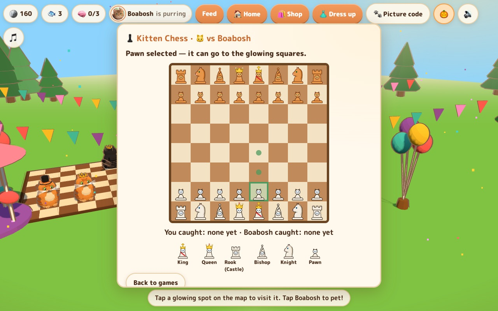
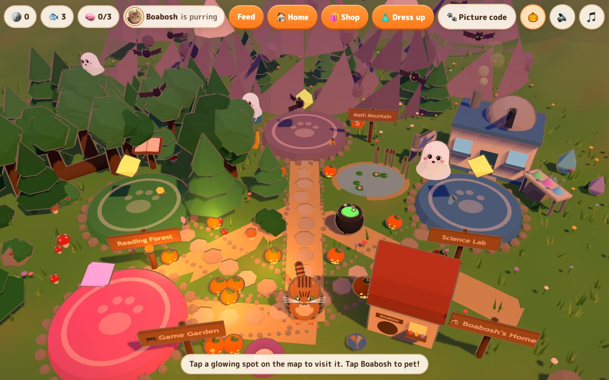

<p align="center"></p>

<h1 align="center">Boabosh's World</h1>

<p align="center">A cozy 3D learning game for kids in grades 2–4.<br />Learn with Boabosh the tabby cat, earn coins, and take care of your cats.</p>



## Learn

Walk Boabosh to the **Reading Forest**, **Math Mountain** and **Science Lab**. Questions
get harder as you improve (grades 2 to 4), rarely repeat, and every 10 right answers
finishes a lesson with confetti. Boabosh cheers for right answers and gently
encourages after wrong ones.




## Care and decorate

Right answers earn 🪙 coins. Spend them in the **Shop** on clothes, toys, food, furniture
and new cats. At **home**, feed, water, pet, brush and play with your cats, scoop the
litter, and decorate the room your way.




## Play

The **Game Garden** has Kitten Chess, Kitten Tic-Tac-Toe, Paw Rock-Paper-Scissors, Laser Tag, Fish Catch and Yarn Roll.
Play the board games against Boabosh or a friend on the same device. Games cost coins **and** need a full
🧠 brain meter (3 right answers since the last game), so it's always learn a bit, play a bit.



**Fish Catch** is a 40-second, one-player round: slide a finger or mouse, or use the arrow
keys, to catch falling fish and golden fish, and dodge the silly old boots. Score 18 for a trophy.

**Yarn Roll** is cat bowling: pull back on the yarn ball, aim and let go to knock down six
toy mice, with bumpers so no roll is wasted. Knock down 11 in 5 rolls for a 🏆, while your
cat cheers from beside the lane. Drag with a finger or mouse, or use the arrow keys and Space.

**Laser Tag** puts your cat on the Blue team against the Pink team in a neon room, in
😺 Easy, 😼 Medium or 😾 Hard. Friendly toy beams, generous aim help, and tagged cats just
go "Meow!", get dizzy and pop back up. Nobody is ever out; whoever tagged more wins a 🏆.
Play with the arrow keys and Space, or the on-screen stick and TAG button.

## Seasonal

From November 1 through January 6 the world is a snowy Christmas, with decorated trees,
candy canes, jolly snowmen and presents to tap, and Jingle Bells on the music box. The 🎄
button turns it off. In October it's a friendly Halloween sunset instead, with pumpkins,
giggling ghosts and bats, and a 🎃 button.

At Christmas the Game Garden joins in: reindeer knights and Santa-hat pawns on a green and
snowy chess board, Santa-hat kittens in tic-tac-toe, Snowball, Gift Wrap and Scissors with
mittens, a snowy Laser Tag against the Santa-hatted Red team, Stocking Catch, where a red stocking
catches treats and gold stars under string lights and dodges silly lumps of coal, and Snowball Roll,
which bowls a snowball at snowmen and presents between candy-cane bumpers.



## Run it

```bash
npm install
npm run dev
```

Saves stay on the device. To move cats between devices with a 🐾 **picture code**,
connect Supabase. See [docs/DEVELOPING.md](docs/DEVELOPING.md) for that, plus tests
and how the code is laid out.
